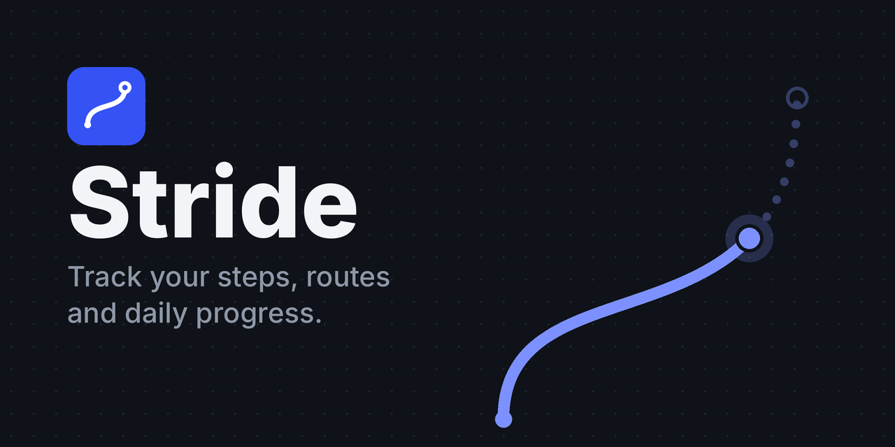

# Stride

A minimalist app that tracks your movement during the day. Steps, GPS routes and reports, in a clean interface made for phones.

**Live app:** https://nikistoichev11-dotcom.github.io/stride/

## Features

- **Today:** step count, goal progress, distance, active minutes, calories and an hour-by-hour chart of your day.
- **Route:** records your GPS path and draws it live with a scale bar. Saves your last 10 routes.
- **Week:** the last 7 days at a glance, with your goal line.
- **Reports:** 7-day and 30-day totals, daily average, best day, goal days, busiest hour and change from the previous period.
- **Private:** everything is stored on your device. Nothing is sent anywhere.
- **Light and dark mode** follow your phone's setting.
- **Demo walk:** try the app without moving.

## Use it

1. Open the live app on your phone.
2. Tap **Start tracking** and allow motion access when asked.
3. Open the **Route** tab and tap **Start route** to record a GPS path.
4. Use **Add to Home Screen** in your browser to open it like an app.

## Good to know

- Step counting and GPS only work while the page is open and the screen is on.
- Sensors need a secure (https) address. GitHub Pages provides one.
- The route is drawn on a plain background. There are no street maps or place names.
- Distance and calories on the Today tab are estimates from your step count (about 0.75 m per step).

## Run it locally

No build step. Open `index.html` in a browser. For sensors and GPS, serve it over https or from `localhost`, for example with `python3 -m http.server`.

## Project files

| File | What it is |
| --- | --- |
| `index.html` | The whole app (HTML, CSS and JavaScript) |
| `manifest.webmanifest` | Lets phones add the app to the home screen |
| `icons/` | App logo and icons |
| `assets/` | Banner image for this README |
| `.nojekyll` | Tells GitHub Pages to serve the files as they are |

## License

MIT. See [LICENSE](LICENSE).
